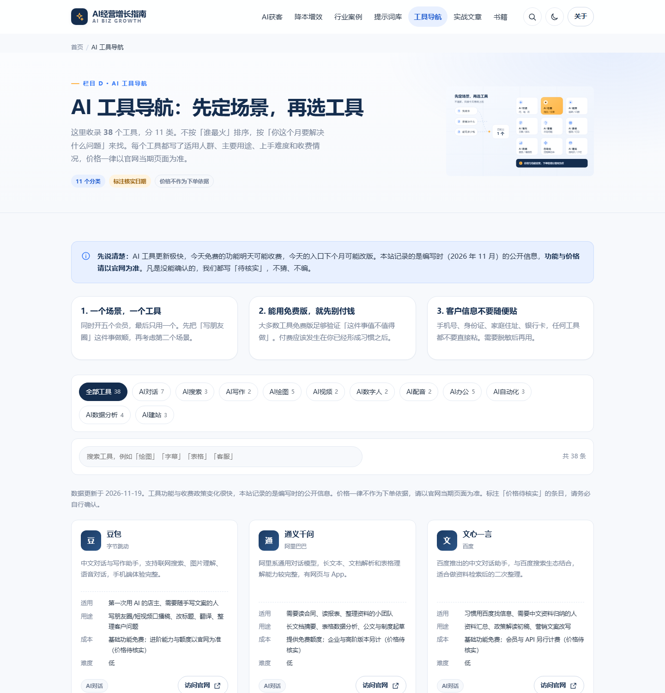
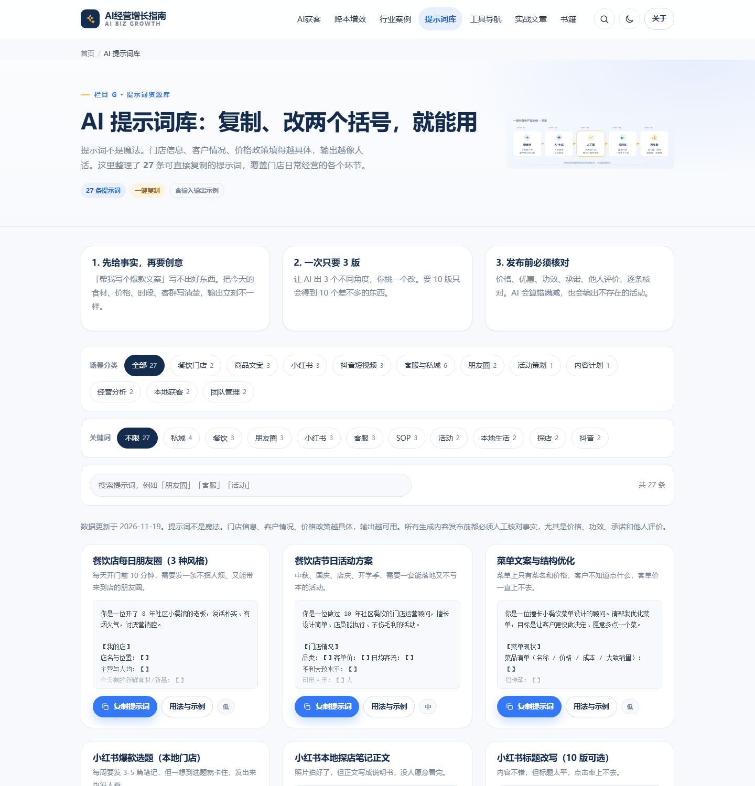
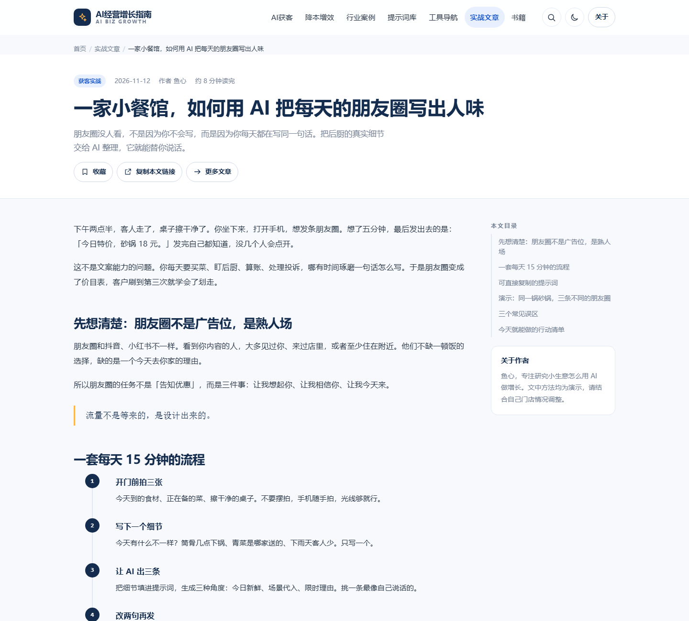

# AI经营增长指南 · ai-biz-growth

> 让不会 AI 的小老板，也能用 AI 做生意。

一个面向中国小微企业、个体工商户、实体门店、自由职业者的 **AI 商业实战知识库**。不追 AI 资讯，不堆概念，只回答三个问题：**客户从哪来、钱从哪里省、这件事今天怎么做完。**

纯静态站点：HTML5 + CSS3 + 原生 JavaScript，零 npm 依赖，所有数据存放在本地 JSON，所有插图为原创 SVG。**没有后端，也不请求任何第三方接口。**

## 页面预览

> 截图由 `node tools/screenshot.js` 调本机 Chrome 无头模式生成，与 `file://` 直接双击打开的效果一致。

<p></p>

<table>
  <tr>
    <td width="50%"></td>
    <td width="50%"></td>
  </tr>
  <tr>
    <td width="50%"></td>
    <td width="50%"></td>
  </tr>
</table>

<p align="center"></p>

---

## 一、本地运行

**两种方式都能用，双击即可看全站：**

- **直接双击 `index.html`**（`file://` 协议）：数据通过 `assets/data/*.js`（普通 `<script>`）加载，图标是内联 SVG sprite，不需要任何服务器。
- **本地 HTTP 服务器**（推荐，URL 更接近线上环境）：

```powershell
# 方式一：Python（Windows 自带或已安装 Python 3）
python -m http.server 8000

# 方式二：Node（无需安装依赖）
npx serve -l 8000
```

然后访问 <http://localhost:8000/index.html>。

> 数据脚本 `.js` 由 `node tools/build-data-js.js` 从同名 `.json` 生成，**改完 JSON 需要重新执行一次**；`node tools/check.js` 会校验两者是否一致。

---

## 二、目录结构

```
ai-biz-growth/
├─ index.html              首页（Hero + 数据价值区 + 四大板块 + 6 个数据模块）
├─ growth.html             AI 获客指南（11 个渠道教程）
├─ efficiency.html         AI 降本增效（15 个场景）
├─ cases.html              行业实战案例（10 个行业 + 30 天计划）
├─ prompts.html            AI 提示词库（27 条，可一键复制）
├─ tools.html              AI 工具导航（38 个工具 / 11 类）
├─ websites.html           AI 网站资源库（31 个入口 / 6 类）
├─ books.html              AI 书籍推荐（21 本 / 7 类）
├─ articles.html           实战文章列表（筛选、标签、收藏）
├─ article-detail.html     文章详情模板（?id=xxx）
├─ about.html              关于我们 / 内容原则 / 使用方法
├─ 404.html                404 页面（不挂常规入口，由服务器返回 404 时展示）
├─ robots.txt
├─ sitemap.html            人类可读的站点地图（页脚「站点地图」指向这里）
├─ sitemap.xml             给搜索引擎的 XML 站点地图
├─ sitemap.xsl             sitemap.xml 的浏览样式（浏览器打开 XML 时渲染成表格）
├─ docs/screenshots/       README 页面截图（node tools/screenshot.js 生成）
└─ assets/
   ├─ css/
   │  ├─ style.css         设计 Token、组件、布局
   │  └─ responsive.css    断点覆盖（1180 / 1080 / 900 / 760 / 560）
   ├─ js/
   │  ├─ main.js           主题、导航、抽屉、复制、收藏、进度条、Toast、表单
   │  ├─ ui.js             数据读取 + 卡片模板 + 通用筛选器
   │  ├─ search.js         全站搜索（8 个 JSON + 10 个页面）
   │  ├─ home.js           首页 6 个模块渲染
   │  ├─ tutorials.js      获客 / 提效教程页
   │  ├─ cases.js          行业方案页
   │  ├─ prompts.js        提示词页 + 详情弹层
   │  ├─ tools.js          工具页
   │  ├─ websites.js       网站资源页
   │  ├─ books.js          书籍页
   │  ├─ articles.js       文章列表（分类 / 标签 / 搜索 / 只看收藏）
   │  └─ article.js        文章详情（TOC、进度、收藏、相关、JSON-LD）
   ├─ data/
   │  ├─ *.json                唯一数据源：所有内容只改这里
   │  ├─ *.js                  构建产物（node tools/build-data-js.js），供 file:// 直接打开时加载
   │  ├─ articles.json         14 篇文章（含正文 HTML）
   │  ├─ tutorials-growth.json 11 个获客教程
   │  ├─ tutorials-efficiency.json 15 个提效场景
   │  ├─ cases.json            10 个行业方案
   │  ├─ prompts.json          27 条提示词
   │  ├─ tools.json            38 个工具
   │  ├─ websites.json         31 个网站
   │  └─ books.json            21 本书
   ├─ svg/                 原创插画与图标（sprite.svg + 7 张场景图 + favicon）
   └─ images/              预留：如需本地照片放这里（当前全部用 SVG，无第三方图片）
```

---

## 三、如何新增内容

所有列表内容都由 JSON 驱动，**改 JSON 即可，不用改 HTML**。

> 每次改完 `assets/data/*.json`，记得执行 `node tools/build-data-js.js` 重新生成同名 `.js`，否则 `file://` 双击打开时看到的还是旧内容。

### 1. 新增一篇文章（`assets/data/articles.json`）

在 `articles` 数组里追加对象：

| 字段 | 说明 |
| --- | --- |
| `id` | 唯一英文短横线 ID，用于 `article-detail.html?id=` 与收藏 |
| `title` / `summary` | 标题 / 摘要（用于卡片、meta description） |
| `category` | `获客实战` / `降本增效` / `工具实战` / `经营方法` |
| `tags` | 字符串数组，会出现在筛选 chips |
| `date` | `YYYY-MM-DD`，列表按此倒序 |
| `author` / `readingTime` | 作者 / 预计阅读分钟数 |
| `coverIcon` | 卡片图标，取 `sprite.svg` 中的 id，如 `i-store` |
| `content` | 正文 HTML 字符串 |

正文约定（与 `article.js` 配合）：

- 用 `<h2>` / `<h3>` 组织内容，TOC 与阅读进度自动生成；
- 提示词用 `<div class="prompt-block"><div class="prompt-block__bar">…<button class="copy-btn" data-copy="…">复制</button></div><pre><code>…</code></pre></div>`；
- 清单用 `<ul class="checklist">`，对比表用 `<div class="table-wrap"><table>…</table></div>`。
- JSON 字符串里**不能出现字面换行**，换行写 `\n`，双引号写 `\"`。

### 2. 新增一个工具（`tools.json`）

必填：`id / name / vendor / category / logo / desc / audience / use / price / url / difficulty / scene / verify`。
`difficulty` 用「低 / 中 / 高」；`price` 拿不准就写「（价格待核实）」，`verify` 写「功能已核实（YYYY-MM）；价格待核实」。**不要编造官网链接、功能或价格。**

### 3. 新增一条提示词（`prompts.json`）

必填：`id / title / category / tags / level / scene / prompt / usage / input / output / tips / tools`。
`prompt` 是完整可复制文本，用 `\n` 分段；`usage` 是使用方法；`input` / `output` 是输入输出示例；`tips` 是字符串数组。

### 4. 新增获客教程 / 提效场景

- `tutorials-growth.json` → `growth.html`
- `tutorials-efficiency.json` → `efficiency.html`

字段：`id / title / subtitle / desc / tags / budget / time / difficulty` + 十个内容字段（`fit / problem / prepare / tools / steps / prompt / example / mistakes / metrics / action`）。`steps`、`action`、`tools` 等为字符串数组。

### 5. 新增行业方案（`cases.json`）

必填：`id / name / icon / tagline / pain / scenes / stack / flow / prompt / samples / budget / difficulty / plan`。`plan` 为 4 周（30 天）数组。

### 6. 新增书籍（`books.json`）/ 网站（`websites.json`）

- 书籍：`id / title / author / category / level / core / fit / learn / relate`。**只收真实出版物**，分类需落在 7 个既定分类内。
- 网站：`id / name / category / use / scene / url / tip / verify`。优先官方入口。

> 新增后建议顺手更新对应页面顶部的数量文案（如「21 本书」）与 `sitemap.xml`。

---

## 四、交互功能

| 功能 | 实现位置 | 说明 |
| --- | --- | --- |
| 响应式导航 / 汉堡菜单 | `main.js` + `.drawer` | ≤1080px 显示抽屉（「关于」也收进抽屉），Esc 关闭，锁定滚动 |
| 全站搜索 | `search.js` | 聚合 8 个 JSON + 10 个页面，`/` 或 `Ctrl+K` 唤起，↑↓ + Enter |
| 分类 / 标签筛选 | `ui.js#bindFilter`、`articles.js` | chips 带数量，无结果有兜底提示 |
| 提示词一键复制 | `main.js#initCopy` | Clipboard API，失败回退 `execCommand`，均失败给出提示 |
| 文章收藏 | `main.js` | `localStorage['abg:favorites']`，列表页可「只看收藏」 |
| 文章目录 / 锚点 | `article.js` | h2/h3 自动编号 `sec-N`，滚动高亮 |
| 阅读进度条 | `main.js#initReadingProgress` | 基于 `#articleBody` 高度，异步渲染后自动接管 |
| 返回顶部 | `main.js#initBackTop` | 滚动 480px 后出现 |
| 暗色模式 | `main.js#initTheme` | `localStorage['abg:theme']`，默认跟随系统 |
| 相关文章 / 上下篇 | `article.js` | 同分类优先，不足按时间补足 |
| 404 / 搜索空状态 | `404.html`、`search.js` | 均提供下一步入口 |
| 订阅表单 | `main.js` | 纯前端演示，不发请求，仅 Toast 提示 |

所有动态内容（文章、工具、提示词等）均通过 `textContent` 或 `escapeHtml()` 输出，避免 XSS。

---

## 五、设计规范

| Token | 值 | 用途 |
| --- | --- | --- |
| `--navy` | `#142D4E` | 主色、标题、深色区块 |
| `--blue` | `#3478F6` | 链接、按钮、强调 |
| `--amber` | `#FFB547` | 强调、数据、重点标签 |
| `--bg` | `#F7F9FC` | 页面背景 |
| `--card` | `#FFFFFF` | 卡片背景 |
| `--ink` | `#263445` | 正文 |
| `--muted` | `#778397` | 辅助文字 |

- 字体：系统中文栈（PingFang SC / Microsoft YaHei / Noto Sans SC），数字与代码用等宽栈。
- 圆角：卡片 16px，按钮药丸形；阴影克制，不使用发光渐变。
- 断点：1180 / 1080 / 900 / 760 / 560。
- 动效：仅 `transform` / `opacity`，并遵守 `prefers-reduced-motion: reduce`。
- 插图：全部为手绘 SVG，无第三方图片、无热链。

---

## 六、SEO 与可访问性

- 每页独立 `title` / `description` / `keywords` / `canonical` / Open Graph。
- 语义化结构：`header` / `nav` / `main` / `section` / `article` / `aside` / `footer`；每页唯一 `h1`。
- 结构化数据：列表页 `CollectionPage`，文章页动态注入 `Article` + `BreadcrumbList`，关于页 `AboutPage`。
- 面包屑、跳过导航链接（skip-link）、`aria-current`、`aria-pressed`、`focus-visible`。
- 图片均有 `alt`，非首屏 `loading="lazy"`，Hero 图 `fetchpriority="high"`。
- `robots.txt` + `sitemap.xml`（含 14 篇文章 URL）+ `sitemap.html`（人类可读版，页脚可直达）。

**站点地址**：全站 `canonical` / `og:url` / JSON-LD / `sitemap.xml` / `robots.txt` 统一为 `https://yuxin.run/ai-biz-growth/`（子目录部署，路径前缀不可省略）；`tools/check.js` 的 `SITE` 常量会校验收尾地址是否一致。

---

## 七、内容原则（重要）

1. **不伪造数据。** 首页数据区是「本站内容数量统计」；图表标注「演示数据」；案例中的门店、金额、对话均为教学演示。
2. **不承诺效果。** 不保证流量、排名、营业额，不写「一个月涨粉十万」。
3. **不虚构工具与书籍。** 工具价格统一写「以官网为准」，无法确认的标「待核实」；书籍只收真实出版物，不提供购买链接、不拿分成。
4. **说明时效。** 工具页、网站页、书籍页顶部标注数据更新月份（当前为 2026-11）。
5. **提示词必须可复制、可核对。** 所有生成内容在发布前需人工核对价格、功效、承诺与评价。

免责声明：本站内容为经营方法演示与学习参考，不构成法律、财税、医疗或投资建议，也不构成任何经营效果承诺。

---

## 八、维护脚本（tools/）

站点本身零依赖，`tools/` 下的 Node 脚本只是本地构建与自检工具，不参与线上运行。

| 脚本 | 作用 | 什么时候跑 |
| --- | --- | --- |
| `build-data-js.js` | 把 `assets/data/*.json` 生成为同名 `.js`（`window.ABG_DATA`），供 `file://` 直接打开时加载 | 每次改完 JSON |
| `build-sitemap-page.js` | 以 `about.html` 为模板生成 `sitemap.html`，页面与文章清单自动取自目录和 `articles.json` | 新增文章或栏目后 |
| `inline-sprite.js` | 把 `sprite.svg` 内联进所有页面，并把 `<use href="外部文件#id">` 改写为 `<use href="#id">` | 每次改完图标 sprite |
| `stamp-assets.js` | 给 HTML 里的 CSS/JS 打内容指纹 `?v=<sha1>`，避免改完看不到效果 | 每次改完 CSS/JS |
| `screenshot.js` | 调本机 Chrome / Edge 无头模式，重截 `docs/screenshots/` 下的 6 张页面图 | 改版、页面样式变化后 |
| `check.js` | 静态检查：各页基础 SEO、死链、锚点、重复 id、数据字段、数据脚本与 JSON 是否一致、站点地图覆盖是否完整 | 交付前 |
| `check-icons.js` | 校验 JS 里 `icon('i-xxx')` 用到的 id 都存在于 sprite | 新增图标或页面脚本后 |

一条命令跑完整个构建 + 自检：

```powershell
node tools/build-data-js.js; node tools/build-sitemap-page.js; node tools/inline-sprite.js; node tools/stamp-assets.js; node tools/check.js; node tools/check-icons.js
```

---

## 九、已知限制与后续可做

- **已支持直接双击打开**（`file://`）：数据走 `assets/data/*.js`，图标为内联 SVG sprite。只是不支持 `fetch` 方式的扩展，新增数据仍建议走 `build-data-js.js`。
- **404 页不挂在页脚的常规入口**：只有服务器返回 404 时才会展示。`file://` 直接打开时浏览器不会自动跳转，部署时请把 404 指向 `404.html`（GitHub Pages / Netlify / Vercel 默认识别；Nginx 用 `error_page 404 /404.html`）。
- **文章详情为客户端渲染**（单模板 + `?id=`）。SEO 友好度不如静态预渲染。若正式运营，建议用构建脚本把 14 篇文章预渲染为独立 HTML（如 `articles/restaurant-moments.html`），并同步 `sitemap.xml`。
- 搜索为纯前端字符串匹配，数据量再大时建议改为预生成索引（如 `search-index.json`）。
- 订阅表单为演示，正式上线需接入邮件服务。
- **页面不展示任何邮箱、电话、微信等联系方式**；如需联系渠道，请自行在页脚补充。
- 暗色模式已实现，但 SVG 插画为浅色底，深色模式下作为「白卡片」呈现，属预期效果。

---

## 十、许可与素材

- 代码与原创 SVG 插画：随项目使用。
- 本站不包含任何第三方图片、字体文件或图标库，因此不存在图片授权问题。
- 文中提及的产品名、公司名、书名归各自权利人所有，仅用于说明与评论。